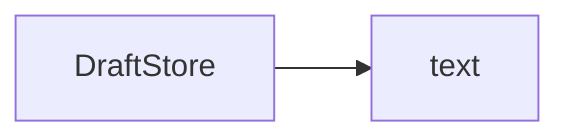
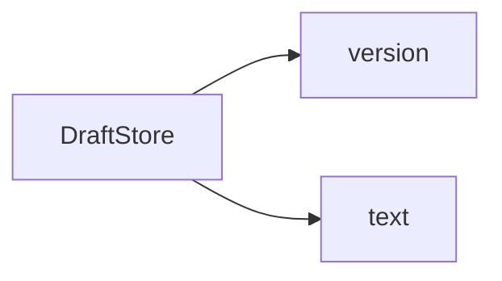

### Overview
The change saves a `Draft` when the composer closes, and it writes drafts in a new `version: 2` shape. It touches `DraftStore` and `ComposerView`.

### Reversibility
Level: Revert with cleanup
- `Sources/Drafts/DraftStore.swift:12`: drafts saved in the new `version: 2` shape stay on disk after a revert. Delete `drafts.json` to clean up.

### Change: Save the draft when the composer closes
- **Files:** `Sources/Composer/ComposerView.swift`, `Sources/Drafts/DraftStore.swift`
- **Why:** The commit says users lost text when they closed the composer.

#### Before
Nothing saved a draft when the composer closed (`Sources/Composer/ComposerView.swift:40`).
```text
ComposerView.onDisappear
  (nothing)
```

#### Now
The composer calls `DraftStore.save`, which writes through `FileStore` (`Sources/Drafts/DraftStore.swift:12`).
```text
ComposerView.onDisappear
  DraftStore.save(draft)
    FileStore.write
```

### Change: Write drafts in the version 2 shape
- **Files:** `Sources/Drafts/DraftStore.swift:12`, `Tests/DraftStoreTests.swift`
- **Why:** The commits give no reason. The new shape lets a later change add fields.

#### Before
`DraftStore` wrote the text only (`Sources/Drafts/DraftStore.swift:10`).


#### Now
`DraftStore` writes a version and the text (`Sources/Drafts/DraftStore.swift:12`).


### Other changes
- `README.md`: the save section names `DraftStore`.
